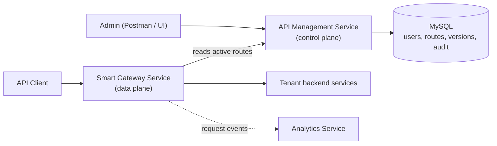

# GateKeeper: Multi-Tenant API Gateway Platform

GateKeeper is an API gateway and API management platform built with Java and Spring Boot. Many companies (tenants) can share one GateKeeper installation. Each company manages its own routes, and the gateway sends live traffic to the right backend service using those routes.

> Built as a learning project while following the Coder Army Spring Boot course, then tested and documented by me.

---

## Why this project

When a backend is split into many services, every service ends up repeating the same work: checking tokens, limiting requests, adding request IDs and handling errors. An API gateway gives clients **one entry point** and applies these rules in one place.

GateKeeper shows how that works inside, with a clear split of responsibilities:

| Service | Role | Job |
|---|---|---|
| `api-management-service` | Control plane | Stores and manages routes, rules, users and history |
| `smart-gateway-service` | Data plane | Receives live requests and forwards them using the rules |
| `analytics-service` | Observation | Collects and reports what happened to requests |

**Control plane decides what should happen. Data plane makes it happen.**

---

## Architecture



**Flow in short**
1. A platform admin creates a company (organization) and its tenant admin.
2. The tenant admin logs in and sets up routes for that company only.
3. The gateway loads the active routes from API Management.
4. A customer request arrives at the gateway, which finds the matching route, applies the rules and forwards the request.

---

## Features

**Implemented**
- Multi-tenant design: every route belongs to one organization
- Management login with JWT
- Role-based access with three roles: `PLATFORM_ADMIN`, `TENANT_ADMIN`, `GATEWAY_SERVICE`
- Tenant isolation: a tenant admin can change only its own organization's routes
- Per-route rules: allowed methods, rate limit, timeout and header rules
- Route versioning: every change to a route saves a new version
- Audit records: who did what, to which resource, and the result
- Gateway reads route settings through API Management (not straight from the database)

**Planned or in progress** *(edit this list to match your code)*
- [ ] Redis for rate limiting and duplicate-request (idempotency) checks
- [ ] Kafka events from the gateway to the analytics service
- [ ] MongoDB storage for analytics data
- [ ] Docker Compose to start everything with one command
- [ ] Automated tests for tenant isolation

---

## Tech stack

- Java, Spring Boot
- Spring Security and JWT
- Spring Data JPA / Hibernate
- MySQL
- Maven
- Postman for testing the APIs

---

## Roles and who can do what

| Role | Belongs to | Can do |
|---|---|---|
| `PLATFORM_ADMIN` | GateKeeper itself | Create, activate, suspend and soft-delete organizations; create the first admin for an organization |
| `TENANT_ADMIN` | One organization | Manage routes, methods, timeouts, rate limits and header rules for that organization only |
| `GATEWAY_SERVICE` | Machine account | Read active route configuration. It cannot create, change or delete routes |

Customers of a tenant's application are **not** GateKeeper users. Their login belongs to the tenant's own application.

---

## Database design

The tables come from the questions the system has to answer.

| Table | Answers |
|---|---|
| `organizations` | Which companies use GateKeeper? Status is `PENDING`, `ACTIVE`, `SUSPENDED` or `DELETED` |
| `management_users` | Who can operate GateKeeper? (`organization_id` is empty for platform-level accounts) |
| `api_routes` | What does the gateway need to handle a request? Unique on `(organization_id, route_id)` |
| `route_allowed_methods` | Which HTTP methods does a route allow? |
| `route_header_rules` | Which headers are added or removed? |
| `route_configuration_versions` | What did a route look like at each version? |
| `control_plane_audit_records` | Who changed what, and what happened? |

---

## API

| Method | Path | Access | Purpose |
|---|---|---|---|
| GET | `/health` | Public | Check that API Management is running |
| POST | `/api/auth/login` | Public | Log in a management user and get a JWT |

All other management endpoints need a valid JWT and the right role. There is **no** `/register` endpoint on purpose (see below).

---

## Design decisions

- **Control plane and data plane are separate.** Changing settings and handling live traffic are different jobs, so they run as different services.
- **Route identity is tenant-scoped.** `organization_id + route_id` identifies a route, so two companies can both have a route called `orders`.
- **Management users are not customers.** Admin credentials are never sent with customer requests.
- **No public registration.** Organizations and admins are created by a platform admin, so nobody can sign themselves up as an admin.
- **Version history has no foreign key to the live route.** A deleted route can still have its history, because live data and history have different lifetimes.
- **Versioning and auditing are different.** Versioning shows what the configuration looked like. Auditing shows who did what and what happened.
- **Status is an enum, not a boolean.** An organization can be pending, active, suspended or deleted.
- **The gateway enforces gateway rules only.** Routing, rate limits, timeouts and headers belong to the gateway. Business checks, such as who can see order 123, stay in the tenant's own backend.

---

## Project structure

```
gatekeeper/
├── api-management-service/   # control plane
├── smart-gateway-service/    # data plane
└── analytics-service/        # events and reports
```

---

## Run it locally

**You need:** Java [17+], Maven, MySQL

1. Clone the repo
   ```bash
   git clone [your-repo-url]
   cd gatekeeper
   ```
2. Create the database
   ```sql
   CREATE DATABASE [your_db_name];
   ```
3. Set your database user and password in `api-management-service/src/main/resources/application.properties`
4. Start the services, one terminal each
   ```bash
   cd api-management-service && ./mvnw spring-boot:run
   cd smart-gateway-service  && ./mvnw spring-boot:run
   cd analytics-service      && ./mvnw spring-boot:run
   ```
5. Check it works
   ```bash
   curl http://localhost:[port]/health
   ```

---

## Try it

1. Log in as a platform admin: `POST /api/auth/login`
2. Create an organization and its tenant admin
3. Log in as the tenant admin and create a route
4. Send a request through the gateway and see it forwarded
5. Log in as a different tenant's admin and confirm you **cannot** change the first tenant's routes

---

## What I learned

- Splitting a system into services by responsibility, not just by project
- Keeping admin identity and customer identity separate
- Designing a tenant-safe database
- Keeping configuration history and audit trails
- Securing APIs with Spring Security and JWT

---


## Author

**Soumika Sahoo** · [LinkedIn]([your-link]) · [GitHub](https://github.com/SoumikaSahoo)
